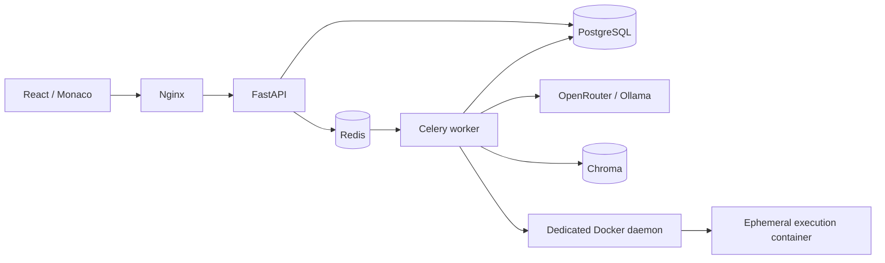

# LeetBug

A debugging practice platform built with **FastAPI**, **React + TypeScript + Vite**, and **Docker Compose**. It implements all three phases of the [PRD](<Product Requirements Document (PRD) LeetBug.md>): manual debugging, AI-directed fixes, stateful evaluation, documentation-backed hints, and community learning.

## Start the application

The deployment is defined in `docker-compose.yaml`. Install Docker with Compose, then run:

```sh
sh scripts/setup.sh
```

Open **http://localhost:8080** and create an account. API documentation is at **http://localhost:8080/api/docs**. No pre-created account or model API key is required for manual debugging.

The first start downloads dependencies and builds the five-language execution image inside the dedicated sandbox daemon. The library may appear before the execution worker is ready. Check startup with:

```sh
docker compose ps -a
docker compose logs -f --tail=30 sandbox-build worker
```

Subsequent starts reuse the image and persistent volumes. `docker compose down` stops the application and preserves data. After editing code, use `docker compose up -d --build`.

`scripts/setup.sh` creates a private `.env` with a generated database password if one does not exist. Alternatively, copy `.env.example` to `.env`, set the values, and run `docker compose up -d --build`. Configure credentials **before the first database initialization**; changing `POSTGRES_PASSWORD` alone does not rotate a password in an existing PostgreSQL volume.

For a different port, change both `APP_PORT` and the corresponding origin in `ALLOWED_ORIGINS`.

## What is included

- 100 executable case studies: 25 each for runtime, logic, business flow, and edge cases, with 134 language variants and 621 public/hidden test cases. Each case includes buggy starter code, three progressive hints, and a reference solution. The catalog has search, tags, category/language/difficulty/progress filters, ordering, five pages of problems, and bookmarks.
- A simple interface with persistent light and dark themes, matching Monaco and notifications. Contextual actions open a case, resume a submission, request guidance, share a fix, and continue to the next challenge.
- Locally bundled Monaco with highlighting, find, folding, bracket matching, and completion; language-specific drafts survive reloads. No Monaco CDN dependency.
- Manual and AI-assist modes, public runs, full submissions, queued/running/completed feedback, readable errors, and per-case state assertions.
- Python, Java 17, JavaScript, C++17, and Go execution. Problems offer the languages appropriate to their scenario.
- Real rollback, authorization, idempotency, and synchronized multithreaded wallet challenges, plus search, sorting, graphs, Unicode, parsing, dynamic programming, exact decimals, graduated billing, atomic cart reservations, buffered event replay, rate limits, cancellations, and waitlist workflows.
- Argon2 password hashing, revocable database-backed sessions in HttpOnly cookies, CSRF tokens, request-origin validation, rate limits, and ownership checks.
- Submission history with editor restoration, optimal solutions unlocked by an accepted full submission, and optional sharing of accepted code/prompts.
- Discussions linked to case studies, replies, votes, and author-controlled deletion.
- General and AI prompt-efficiency leaderboards, a personal progress dashboard, streaks, activity heatmaps, achievements, and platform KPIs.
- Chroma vector retrieval over official-documentation summaries, live-document ingestion, optional semantic embeddings, and progressive hints after repeated failures.
- PostgreSQL migrations, idempotent catalog seeding, persistent infrastructure volumes, health checks, bounded execution jobs, and orphan cleanup.

See [docs/PRD_COVERAGE.md](docs/PRD_COVERAGE.md) for the requirement-by-requirement map.
The completed local checks and remaining performance limits are recorded in [docs/VERIFICATION.md](docs/VERIFICATION.md).

## AI providers

AI code generation uses real OpenAI-compatible chat-completion requests. If no provider is configured, manual execution and documentation-based hints work, and the AI tab explains the missing configuration. No fake generated fixes are returned.

**OpenRouter:** set these in `.env`, then recreate the API and worker:

```dotenv
AI_PROVIDER=openrouter
AI_API_KEY=your-openrouter-key
AI_MODEL=your-provider/model-id
```

```sh
docker compose up -d api worker scheduler
```

**Ollama:** set `AI_PROVIDER=ollama` and a model name, then start the optional service and pull the model:

```dotenv
AI_PROVIDER=ollama
AI_MODEL=qwen2.5-coder:7b
COMPOSE_PROFILES=ollama
```

```sh
docker compose --profile ollama up -d
docker compose exec ollama ollama pull qwen2.5-coder:7b
```

`qwen2.5-coder:0.5b` is a smaller option for integration testing; it produces weaker fixes. To use Ollama running on a macOS host, set `AI_BASE_URL=http://host.docker.internal:11434/v1`. On Linux, configure an appropriate reachable host address or use the Compose service. On CPU-only Docker Desktop, the larger model can be slow. API and task timeouts bound failures; no latency target is assumed to be met just because a provider is configured.

The providers use the request formats described in the [OpenRouter reference](https://openrouter.ai/docs/api_reference/overview) and [Ollama OpenAI compatibility documentation](https://docs.ollama.com/api/openai-compatibility). Prompts, current code, and public requirements go to the chosen provider; hidden test oracles do not. Hint generation falls back to the retrieved documentation and curated guidance after 12 seconds; code generation has a separate 60-second provider deadline.

## Documentation retrieval and hints

The startup indexer upserts reviewed, source-linked summaries of Python, Java, JavaScript, C++, and Go documentation into Chroma. The default embedding is a normalized, deterministic 384-dimensional feature-hash vector. This is **lexical vector retrieval**, usable offline without downloading a model.

To enable **semantic embeddings** through Ollama:

```sh
docker compose --profile ollama up -d ollama
docker compose exec ollama ollama pull nomic-embed-text
```

```dotenv
EMBEDDING_BASE_URL=http://ollama:11434/v1
EMBEDDING_MODEL=nomic-embed-text
```

```sh
docker compose up -d --force-recreate docs-index worker
```

Each embedding configuration uses its own collection, preventing vector-space mixing. Embedding requests are batched so a full documentation refresh works with local model capacity. Refresh the index with actual official web pages using:

```sh
docker compose exec worker python -m app.ingest_docs --refresh
```

The refresh command only fetches the reviewed official domains listed in `backend/app/documents.py`; it chunks their main content and preserves source URLs. Existing bundled summaries remain available. If Chroma is down, hints fall back to local ranked documentation summaries. If a model is down, hints fall back to the curated progressive guidance. The API records the retrieval/fallback method, and every hint exposes its sources.

## Architecture and execution boundary



Only Nginx publishes a host port. PostgreSQL, Redis, Chroma, and the execution daemon are private Compose services. API services do not receive a Docker socket. The worker and scheduler are the only long-running application services connected to the execution network.

Each evaluation creates a fresh unprivileged container, with a read-only root filesystem, no network, dropped capabilities, no-new-privileges, a 512 MB memory/swap ceiling, one CPU, a PID cap, a bounded temporary filesystem, and bounded stdout/stderr. There are no host bind mounts. The harness compiles once, then launches a fresh process for each input with a two-second execution deadline. Worker-side grading compares JSON values and state paths against expectations that **never enter the execution container**. A program cannot choose its own accepted status. Hidden inputs, expected outputs, and runtime messages are omitted from API feedback.

The Docker-in-Docker service itself requires `privileged` for its nested daemon. It is a trusted infrastructure component, not the submitted-code container. For an internet-facing multi-tenant installation, deploy this stack on a dedicated execution host/VM and protect the host boundary; ordinary containers share a kernel and are not a VM-grade hostile-code boundary. Never publish daemon port 2375 or attach unrelated services to the execution network. See the [Docker security documentation](https://docs.docker.com/engine/security/) for the daemon trust model.

Turnaround is measured outside the sandbox from submission creation to completion. Runtime is measured outside the container and includes startup and compilation. Memory is peak child-process RSS reported by the harness, including compilation; it is useful feedback rather than tamper-proof competitive telemetry. Public runs never unlock solutions or enter rankings.

## Development

Use Docker for the API, queue, persistence, and actual execution, with Vite on the host:

```sh
docker compose -f docker-compose.yaml -f docker-compose.dev.yaml up -d --build
cd frontend
npm ci
npm run dev
```

Vite serves at http://localhost:5173 and proxies `/api` to port 8000. The development overlay publishes port 8000 on loopback only and reloads API source. Production Compose does not publish the API directly.

For backend tests and schema work:

```sh
python3 -m venv .venv
.venv/bin/pip install -e './backend[dev]' -c backend/requirements.lock
cd backend
../.venv/bin/alembic upgrade head
```

The local default database is SQLite for tests/development tools. Compose always uses PostgreSQL. Production schema changes belong in Alembic migrations. New cases belong in `backend/app/catalog.py`; the seed command inserts new slugs without overwriting existing content.

## Verification

```sh
# API behavior, auth, grading, provider contracts, RAG fallback, and analytics
.venv/bin/pytest backend/tests -q
.venv/bin/ruff check backend

# Strict TypeScript, React lint, and the production frontend
cd frontend
npm run check
npm run build
npm audit

# Browser-to-API-to-worker flows against the running Compose application
npx playwright install chromium
npm run test:e2e

# Also exercise the real AI prompt UI, generated patch, and leaderboard
LEETBUG_LIVE_AI=1 npm run test:e2e -- --grep 'live AI'

# All buggy starters and optimal solutions, in every offered language,
# plus network, filesystem, identity, timeout, output, and grading probes
docker compose exec worker python -m app.verify_catalog

# Smaller persisted HTTP smoke flow (from the repository root)
.venv/bin/python scripts/smoke.py
.venv/bin/python scripts/smoke.py --ai
```

Browser and HTTP smoke tests create uniquely named local test accounts. Catalog verification does not create history. OpenRouter contract tests use an HTTP test double; live provider checks require the corresponding configured service or credentials.

## Operations

- For public HTTPS, place a TLS reverse proxy in front of the web service, set `COOKIE_SECURE=true`, and set `ALLOWED_ORIGINS` to the exact HTTPS origin. Keep `SEED_DEMO_USER=false`.
- `GET /api/health` checks the API process; `GET /api/ready` checks database and queue connectivity. Worker health is exposed by Compose. Hints have a documented fallback if Chroma or the model is unavailable.
- Celery uses JSON-only messages, late acknowledgements, bounded task lifetimes, and one prefetched job per worker process. A per-user cap limits simultaneous evaluations. The scheduler expires abandoned jobs and removes expired sandbox containers.
- Back up PostgreSQL and the persistent Chroma volume. Redis uses AOF persistence; PostgreSQL remains the durable source of submission state.
- Inspect errors with `docker compose logs --tail=100 api worker scheduler`. An infrastructure failure produces a persisted service-error attempt and does not count against completion metrics.
- Do not use `docker compose down -v` unless you intend to delete all application data, models, and the cached execution image.
